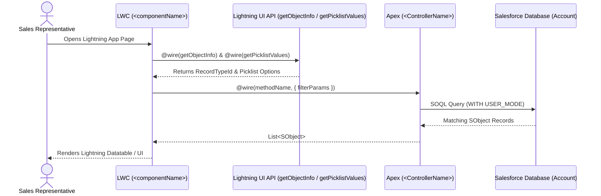

# Detailed Design Document: <Feature Title>

## 1. Document Overview & Metadata
| Attribute | Details |
| :--- | :--- |
| **Feature Name** | `<Feature Title>` |
| **Functional Spec Reference** | [`docs/specs/<feature-slug>.md`](../specs/<feature-slug>.md) |
| **Author** | Salesforce Developer Subagent (`sfdc-dev`) |
| **Salesforce API Version** | `68.0` |
| **Status** | `Implemented` |

### 1.1 Executive Summary
Provide a concise technical summary of the solution, the business problem it solves, and the architectural pattern chosen (e.g., LWC + Reactive `@wire` Apex Controller + User Mode SOQL).

---

## 2. Solution Architecture & Data Flow

### 2.1 Component Architecture Diagram
Use a Mermaid diagram (`flowchart` or `sequenceDiagram`) to illustrate the end-to-end interaction between the User, Lightning App Page, LWC, Lightning Data Service (UI API), Apex Controller, and Salesforce Database.



---

## 3. Data Model & Schema Design

### 3.1 Standard & Custom Objects
| Object API Name | Type (Standard / Custom) | Sharing Model (OWD) | Purpose in Solution |
| :--- | :--- | :--- | :--- |
| `Account` | Standard | Organization Default (`with sharing` enforced) | Primary data source for customer accounts. |

### 3.2 Fields Specification
| Object | Field API Name | Field Label | Data Type | Values / Length / Formula | Required | FLS / Security Notes |
| :--- | :--- | :--- | :--- | :--- | :--- | :--- |
| `Account` | `CustomerPriority__c` | Customer Priority | Picklist (Restricted) | `High`, `Medium`, `Low` | No | Read/Edit granted via Permission Set |

---

## 4. Backend Design (Apex & Automation)

### 4.1 Apex Classes & Methods
| Class Name | Sharing Declaration | Method Signature | Annotations | Description |
| :--- | :--- | :--- | :--- | :--- |
| `<ControllerName>` | `public with sharing` | `public static List<SObject> <methodName>(...)` | `@AuraEnabled(cacheable=true)` | Queries records enforcing user-mode security. |

### 4.2 SOQL Queries, Selective Filtering & Indexing
- **Query Structure**: Document the exact SOQL query and bind variables.
- **Selectivity & Performance**: Explain indexed fields used in `WHERE` / `ORDER BY` clauses and `LIMIT` thresholds.

### 4.3 Governor Limits & Bulkification Analysis
| Resource / Limit | Governor Limit (Synchronous) | Solution Usage | Mitigation Strategy |
| :--- | :--- | :--- | :--- |
| **SOQL Queries** | 100 | 1 per transaction | Single static query outside loops; `@AuraEnabled(cacheable=true)` client caching. |
| **SOQL Query Rows** | 50,000 | Max 200 | Explicit `LIMIT 200` guard. |
| **DML Statements** | 150 | 0 (Read-only) / Bulkified | List-based DML only. |

### 4.4 Error & Exception Handling
- Describe how backend exceptions (e.g., `QueryException`, `SecurityException`, inaccessible fields under `WITH USER_MODE`) are caught and surfaced to the frontend via `AuraHandledException`.

---

## 5. Frontend Design (Lightning Web Components)

### 5.1 Component Inventory & Configuration
| LWC Name | API Version | Targets (`js-meta.xml`) | Description |
| :--- | :--- | :--- | :--- |
| `<componentName>` | `68.0` | `lightning__AppPage`, `lightning__HomePage`, `lightning__RecordPage` | Main UI component. |

### 5.2 State Management, Properties & Wire Adapters
| Property / Wire Adapter | Type / Decorator | Reactive Parameters | Purpose |
| :--- | :--- | :--- | :--- |
| `selectedFilter` | Reactive Property | — | Stores current user filter selection. |
| `wiredRecords` | `@wire(<apexMethod>)` | `{ filter: '$selectedFilter' }` | Reactively fetches records when filter changes. |

### 5.3 UI States & Accessibility (SLDS)
- **Loading State**: `lwc:if={isLoading}` with `lightning-spinner` (`alternative-text` provided).
- **Error State**: `lwc:elseif={errorMessage}` with SLDS alert banner (`role="alert"`, `.slds-alert_error`).
- **Data State**: `lwc:elseif={hasRecords}` with `lightning-datatable` or structured layout.
- **Empty State**: `lwc:else` with clear user guidance when zero records match.

---

## 6. Security & Access Control Design

### 6.1 Sharing & Record-Level Security
- **Class Sharing**: `with sharing` ensures record visibility respects Organization-Wide Defaults (OWD), Role Hierarchy, and Sharing Rules.
- **Field & Object Security**: Queries execute with `WITH USER_MODE` to enforce CRUD and Field-Level Security (FLS) natively.

### 6.2 Permission Sets
| Permission Set API Name | Included Permissions | Target Persona |
| :--- | :--- | :--- |
| `<Permission_Set_Name>` | Apex Class: `<ControllerName>`<br>FLS: `<Object>.<Field>` (Read/Edit) | Sales Representatives |

---

## 7. Testing & Quality Assurance Strategy

### 7.1 Apex Unit Tests (`<TestClassName>.cls`)
| Test Method | Scenario Type | Description & Assertions |
| :--- | :--- | :--- |
| `test...` | Positive (Unfiltered) | Verifies expected records returned and sorted properly. |
| `test...` | Positive / Negative (Filtered) | Verifies filter criteria inclusion/exclusion and empty result behavior. |
| `test...` | Bulk Testing | Verifies 50+ records processed within governor limits. |

### 7.2 LWC Jest Unit Tests (`__tests__/<componentName>.test.js`)
| Test Case | Acceptance Criterion | Verified Behavior |
| :--- | :--- | :--- |
| `AC-1: ...` | AC-1 | Component renders datatable rows, URLs, and flattened relationship fields. |
| `AC-2: ...` | AC-2 | Combobox `change` event updates `@wire` config and refreshes rows. |
| `AC-3: ...` | AC-3 | Empty array hides datatable and renders empty-state message. |
| `AC-4: ...` | AC-4 | Wire error renders accessible alert banner. |

---

## 8. Deployment & Operations Checklist

### 8.1 Metadata Components Inventory (`force-app/main/default/`)
- [ ] `objects/<Object>/fields/<Field>.field-meta.xml`
- [ ] `classes/<ControllerName>.cls` & `.cls-meta.xml`
- [ ] `classes/<TestClassName>.cls` & `.cls-meta.xml`
- [ ] `lwc/<componentName>/*`
- [ ] `permissionsets/<Permission_Set_Name>.permissionset-meta.xml`

### 8.2 Deployment Commands
```bash
# Validate / Deploy metadata to target org
sf project deploy start --source-dir force-app/main/default --test-level RunSpecifiedTests --tests <TestClassName>

# Assign Permission Set to target user
sf org assign permset --name <Permission_Set_Name>
```

### 8.3 Post-Deployment Configuration Steps
1. Assign the `<Permission_Set_Name>` permission set to Sales Rep users.
2. Open **Lightning App Builder**, add the `<MasterLabel>` component to the target Lightning App Page, Save, and Activate.

